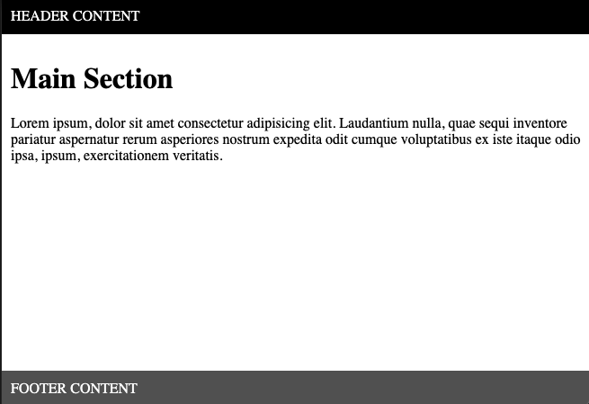
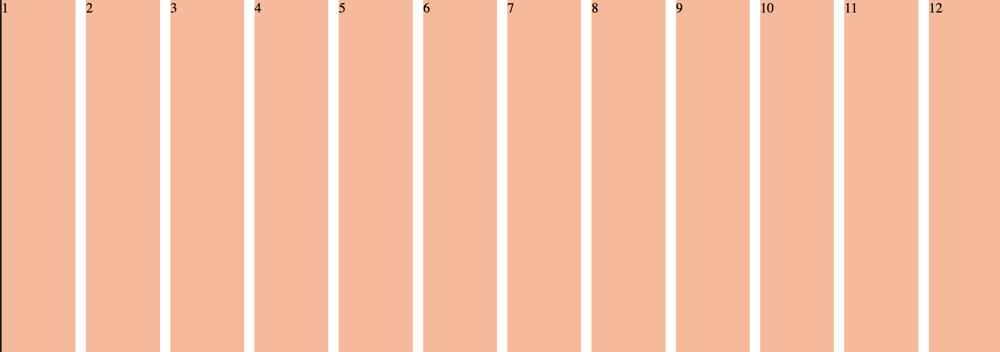
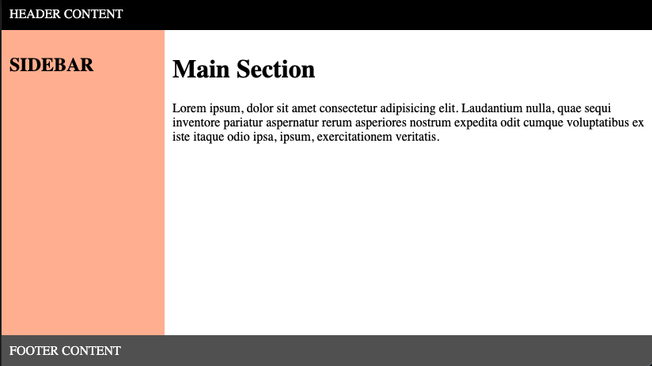
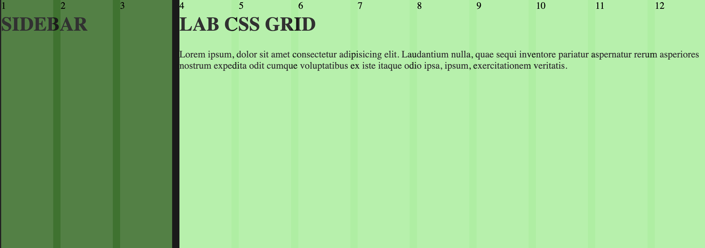
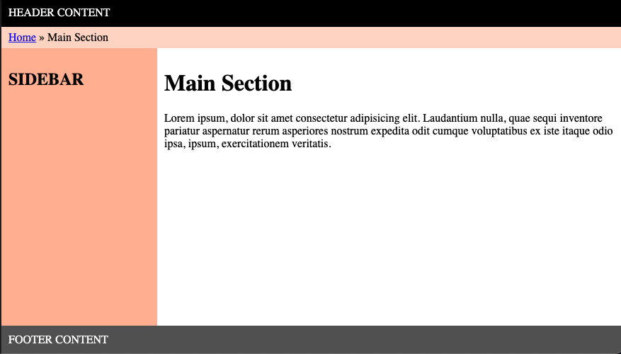
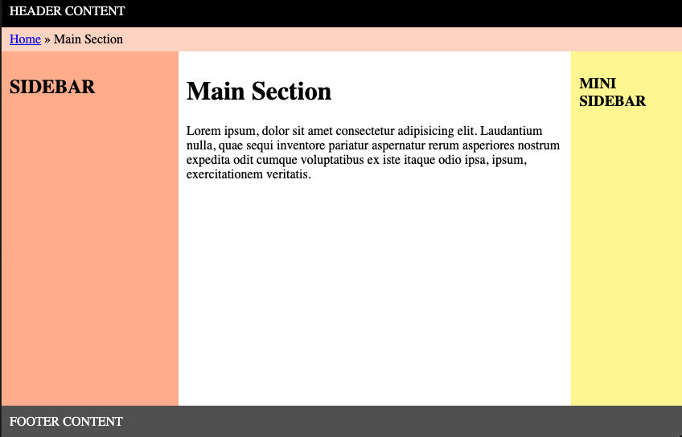

# Responsive Web Design: CSS Grid Lab

In this lab, you will build a sequence of common page layouts with CSS Grid. Each iteration introduces a new grid concept, from full-height rows to a 12-column system, sidebars, and breadcrumbs.

You have already been given:

- Four separate exercise folders under `student_code/`.
- Starting HTML content for each iteration.
- Starting stylesheets with the reference colours where needed.
- A visual reference for every required iteration in `assets/`.
- An additional reference image for the bonus layout.

Complete the iterations in order because Iterations 3 and 4 build on ideas from the earlier work.

## Learning goals

By the end of this lab, you should be able to:

- Create a grid formatting context with `display: grid`.
- Define fixed and flexible tracks with `grid-template-rows` and `grid-template-columns`.
- Build and reason about a 12-column grid system.
- Place content across a chosen number of columns.
- Combine nested grids for page and content layouts.
- Protect responsive columns with sensible minimum sizes.
- Work on a Git branch and submit your solution through a pull request.

## Expected results

### Iteration 1: Header, content, and footer



### Iteration 2: Twelve equal columns



### Iteration 3: Sidebar and main content



The page uses a 12-column content grid. The overlay below makes those columns visible:



### Iteration 4: Breadcrumb bar



### Bonus: Right sidebar



The images define the required order, relative sizes, spacing, and colours. Your layouts should also adapt when the viewport width changes.

## Exercise requirements

### Iteration 1: Header, content, and footer

Work in `student_code/iteration1/index.html` and `student_code/iteration1/styles.css`.

- Create a wrapper with the ID `container`.
- Make `#container` fill the viewport height and use `display: grid`.
- Inside it, use semantic `<header>`, `<main>`, and `<footer>` elements.
- Keep the supplied header, main, lorem ipsum, and footer content.
- Define three grid rows:
  - A `40px` header.
  - A flexible main row that occupies the remaining space.
  - A `40px` footer.
- Apply distinct background colours matching the reference.
- Add enough padding to keep text away from the edges.

### Iteration 2: Twelve equal columns

Work in `student_code/iteration2/index.html` and `student_code/iteration2/styles.css`.

- Create a `.container` with 12 child elements.
- Give every child the class `.column`.
- Add the consecutive text values `1` through `12`, one per column.
- Make the container fill the viewport width and height.
- Use `display: grid` on the container.
- Define 12 equal-width columns with `grid-template-columns` and fractional units.
- Add a `12px` gap between columns.
- Give the columns a light background colour so the grid is visible.
- Confirm that all 12 columns remain equal when the viewport changes width.

### Iteration 3: Sidebar and main content

Work in `student_code/iteration3/index.html` and `student_code/iteration3/styles.css`.

- Begin from your completed Iteration 1 structure and styles.
- Keep the page-level header, flexible content area, and footer rows.
- Inside the flexible content area, create a wrapper with the ID `main-grid`.
- Add a semantic `<aside>` before `<main>`.
- Put an `<h2>` with the text `SIDEBAR` inside the aside.
- Make `#main-grid` a 12-column grid.
- Make the sidebar occupy 3 columns.
- Make the main content occupy the remaining 9 columns.
- Apply the reference colours and spacing.
- Add a sensible minimum width so the sidebar does not become unusably narrow when the browser is resized.

### Iteration 4: Add breadcrumbs

Work in `student_code/iteration4/index.html` and `student_code/iteration4/styles.css`.

- Recreate the completed header, sidebar, main content, and footer layout from Iteration 3.
- Add a breadcrumb bar between the header and the sidebar/main content row.
- Include a `Home` link followed by the current page text `Main Section`.
- Give the breadcrumb its own grid row and style it to match the reference.
- Keep the sidebar at 3 of the 12 content columns and the main area at 9.
- Keep the overall page at least as tall as the viewport, with the main content taking the available space.

### Bonus: Add a right sidebar

Extend Iteration 4:

- Add a second `<aside>` after the main content.
- Place the text `MINI SIDEBAR` inside it.
- Divide the 12-column content grid among the left sidebar, main content, and right sidebar.
- Make the right sidebar narrower than the left sidebar.
- Use the supplied yellow reference colour from the stylesheet comments.
- Preserve the header, breadcrumb, and footer across the full page width.
- Match `assets/iteration-bonus.png` as closely as practical.

## How to run and test the project

This project has no package dependencies or build step.

```bash
# Open all four exercise folders from the repository root in Visual Studio Code.
code student_code
```

Open each `index.html` file directly in a browser or use the Live Server extension in Visual Studio Code.

For every iteration:

- Compare the result with its corresponding image in `assets/`.
- Resize the browser horizontally and check how the grid tracks respond.
- Confirm that the layout fills the viewport height where required.
- Check the browser console for missing stylesheet errors.

## How to complete and submit the lab

Follow these steps in order. Read the comments above each command before running it.

### 1. Fork the teacher's repository

1. Open `https://github.com/RaulAM7/LAB-CSS-Responsive-Web-Design-Grid-starter` in your browser.
2. Select **Fork** in the top-right corner.
3. Keep your own GitHub account as the owner.
4. Select **Create fork**.

Your fork is your own GitHub copy of the exercise. You will push your work there before creating a pull request for your teacher.

### 2. Clone your fork

Replace `YOUR_GITHUB_USERNAME` with your real GitHub username.

```bash
# Download your fork from GitHub to your computer.
git clone https://github.com/YOUR_GITHUB_USERNAME/LAB-CSS-Responsive-Web-Design-Grid-starter.git

# Move into the project directory that Git has just created.
cd LAB-CSS-Responsive-Web-Design-Grid-starter

# Check that origin points to the repository under your own GitHub account.
git remote -v
```

### 3. Connect your clone to the teacher's repository

```bash
# Add the teacher's public repository as a second remote named upstream.
git remote add upstream https://github.com/RaulAM7/LAB-CSS-Responsive-Web-Design-Grid-starter.git

# Confirm that origin is your fork and upstream is the teacher's repository.
git remote -v
```

### 4. Create your solution branch

Replace `YOUR_NAME` with your name in lowercase and without spaces. For example: `solution/maria`.

```bash
# Create a separate branch for your solution and switch to it immediately.
git switch -c solution/YOUR_NAME

# Confirm that Git shows an asterisk next to your solution branch.
git branch
```

Do not complete the exercise directly on `main`.

### 5. Complete and test the exercise

Complete the HTML and CSS files in each iteration folder:

- `student_code/iteration1/`
- `student_code/iteration2/`
- `student_code/iteration3/`
- `student_code/iteration4/`

Test an iteration before using its ideas in the next one.

### 6. Review your changes

```bash
# Show your current branch and every file you have changed.
git status

# Show the exact changes across all four iteration folders.
git diff -- student_code/iteration1/index.html student_code/iteration1/styles.css student_code/iteration2/index.html student_code/iteration2/styles.css student_code/iteration3/index.html student_code/iteration3/styles.css student_code/iteration4/index.html student_code/iteration4/styles.css
```

### 7. Prepare your commit

```bash
# Add only the eight reviewed HTML and CSS exercise files.
git add -- student_code/iteration1/index.html student_code/iteration1/styles.css student_code/iteration2/index.html student_code/iteration2/styles.css student_code/iteration3/index.html student_code/iteration3/styles.css student_code/iteration4/index.html student_code/iteration4/styles.css

# Show the exact changes that will be included in the commit.
git diff --staged

# Save the staged changes with a short and meaningful message.
git commit -m "Complete responsive CSS Grid lab"
```

### 8. Push your branch

```bash
# Upload your solution branch to your own GitHub fork.
git push -u origin solution/YOUR_NAME
```

### 9. Open the pull request

1. Open your fork on GitHub.
2. Select **Compare & pull request**.
3. Confirm that the base repository is `RaulAM7/LAB-CSS-Responsive-Web-Design-Grid-starter`.
4. Confirm that the base branch is `main`.
5. Confirm that the compare branch is `solution/YOUR_NAME` from your fork.
6. Add a clear title and summarise which iterations and bonus work you completed.
7. Select **Create pull request**.

Do not merge the pull request yourself. Wait for your teacher's review.

### 10. Apply review feedback

Push corrections to the same branch. The existing pull request will update automatically.

```bash
# Switch to the same solution branch used by the pull request.
git switch solution/YOUR_NAME

# Check the files changed after applying the review feedback.
git status

# Add only the corrected HTML and CSS exercise files.
git add -- student_code/iteration1/index.html student_code/iteration1/styles.css student_code/iteration2/index.html student_code/iteration2/styles.css student_code/iteration3/index.html student_code/iteration3/styles.css student_code/iteration4/index.html student_code/iteration4/styles.css

# Save the corrections in a new commit.
git commit -m "Apply review feedback"

# Upload the new commit and update the existing pull request.
git push
```

## Useful Git command summary

| Command | What it does |
| --- | --- |
| `git status` | Shows your branch and the state of your files. |
| `git diff` | Shows changes that have not been staged. |
| `git diff --staged` | Shows changes prepared for the next commit. |
| `git add -- FILE` | Adds one specific file to the staging area. |
| `git commit -m "MESSAGE"` | Saves the staged changes in the local Git history. |
| `git push` | Uploads your local commits to GitHub. |
| `git log --oneline` | Shows a compact list of your commits. |

## Before submitting

- [ ] Iteration 1 uses three page rows with a flexible main section.
- [ ] Iteration 2 displays 12 equal columns with `12px` gaps.
- [ ] Iteration 3 uses a 3-column sidebar and a 9-column main area.
- [ ] Iteration 4 includes a breadcrumb row between the header and content.
- [ ] The layouts respond sensibly when the browser width changes.
- [ ] The optional right sidebar is narrower than the left one, if attempted.
- [ ] All four HTML files load their local stylesheets.
- [ ] `git status` does not show accidental files.
- [ ] The work is committed on `solution/YOUR_NAME`.
- [ ] The branch has been pushed to the student's fork.
- [ ] The pull request targets the teacher's `main` branch.

Happy coding!
